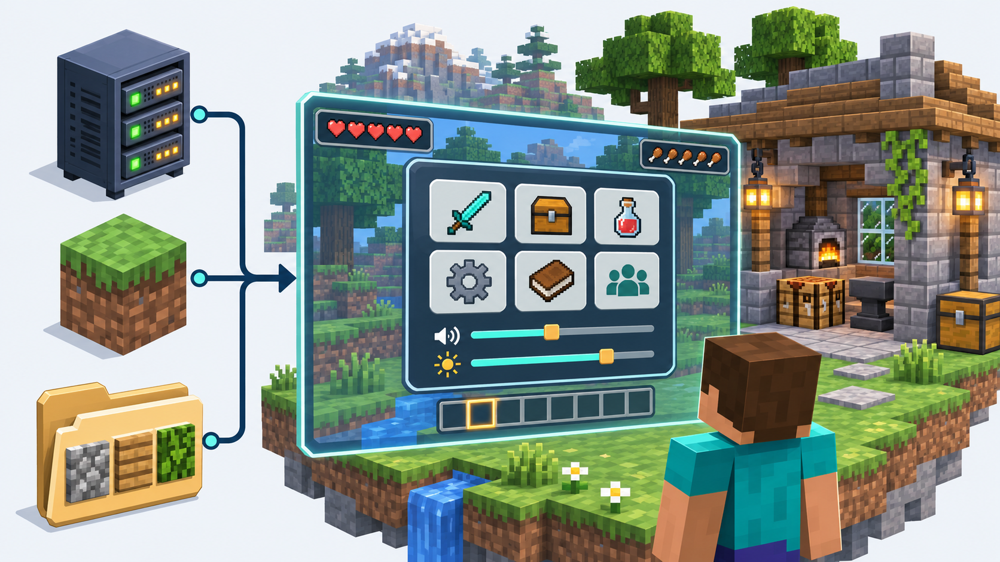
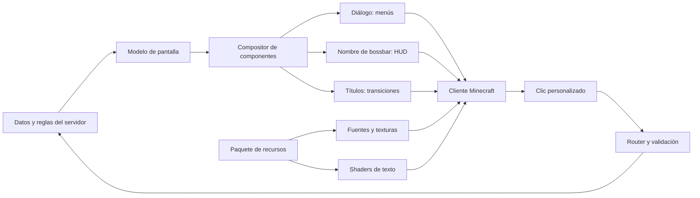
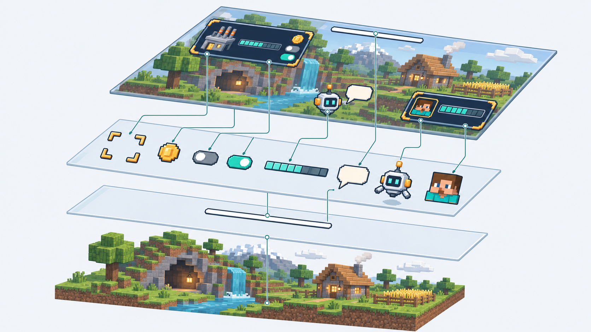

# Guía para construir interfaces y HUD en Minecraft Java

Esta guía explica cómo crear un sistema de interfaces para un servidor de Minecraft Java: menús con botones, interruptores y tooltips; formularios; paneles visibles durante el juego; y transiciones gráficas. El jugador utiliza un cliente compatible y carga el paquete de recursos del servidor.

La solución combina tres piezas: un plugin mantiene los datos y las acciones, las funciones nativas de Minecraft transportan las pantallas y mensajes, y un paquete de recursos aporta imágenes, fuentes y shaders. Primero se construye una interfaz sencilla; después se añaden las capas gráficas y la persistencia.

No hace falta experiencia previa con shaders para entender la arquitectura. Para implementar el sistema sí se necesita programar en la plataforma de servidor elegida, editar archivos JSON y crear los recursos gráficos. La guía presenta decisiones y ejemplos; no es un plugin completo listo para instalar.



El servidor aporta las reglas; Minecraft, los canales y controles; el paquete, la apariencia. El menú se abre al interactuar y el HUD permanece durante el juego. Ilustración conceptual generada con IA.

## 1. Qué vas a construir

| Funcionalidad | Función de Minecraft | Trabajo de tu sistema |
|---|---|---|
| Menús | Diálogos nativos | Componer pantallas y navegación |
| Paneles e iconos | Fuentes bitmap y texturas | Crear glifos, métricas y layout |
| Botones | Eventos de clic en componentes | Enrutar y validar acciones |
| Tooltips | Eventos de hover | Explicar objetos y acciones |
| Interruptores | Componentes clicables | Alternar estado y cambiar la imagen |
| Formularios | Inputs nativos de diálogos | Validar texto, selección y cantidades |
| HUD persistente | Nombre de bossbar | Componer paneles y actualizar datos |
| HUD en diferentes posiciones | Shader de texto del paquete | Definir marcadores y anclajes |
| Transiciones | Títulos y shader de fragmentos | Controlar efecto, progreso y limpieza |
| Mascota y notificaciones | Glifos, texto, sonidos y canales alternativos | Gestionar mensajes y preferencias |
| Idiomas y preferencias | Texto y componentes | Traducciones y almacenamiento |
| Integración con economía o máquinas | APIs y servicios del servidor | Suministrar datos y ejecutar reglas |

Un **diálogo** es una pantalla interactiva que se abre y se cierra. Un **HUD** es información superpuesta mientras juegas. Un **glifo** es la representación visual de un carácter; aquí puede ser un icono o un panel. Un **shader** es un programa de renderizado que puede modificar cómo se dibujan esos elementos.

## 2. Arquitectura



Hay dos rutas distintas. Los diálogos ofrecen pantalla modal, interacción y controles; el HUD aprovecha un canal de texto que ya se dibuja durante el juego. El shader transforma la presentación del texto recibido. Las reglas, permisos, recompensas y preferencias viven en el servidor.

## 3. Elegir y fijar una versión

Los diálogos existen desde Java 1.21.6, pero el formato de recursos, las firmas de los shaders y las APIs de servidor cambian entre versiones. La documentación oficial describe el [formato de diálogos](https://www.minecraft.net/en-us/article/minecraft-java-edition-1-21-6).

Para un proyecto propio:

1. Elegir una versión exacta de Minecraft cliente y servidor.
2. Elegir una plataforma con soporte para esa versión. Paper es una opción si dispone de una compilación compatible con la versión que elijas.
3. Fijar la versión de la API, del JDK y de las herramientas de compilación.
4. Partir de los shaders originales del JAR de esa versión y aplicar cambios pequeños sobre ellos.
5. Probar primero con un cliente vanilla y después con las combinaciones de mods gráficos que se quieran soportar.

Los ejemplos de esta guía son piezas de diseño y configuración. No forman un plugin completo compilado ni un shader universal listo para todas las versiones. Las firmas de API deben contrastarse con el servidor elegido.

## 4. Estructura del proyecto

```text
mi-interfaz/
├── plugin/
│   └── src/main/java/.../
│       ├── UiService.java
│       ├── UiSession.java
│       ├── ActionRouter.java
│       ├── DialogRenderer.java
│       ├── HudRenderer.java
│       ├── LayoutComposer.java
│       ├── GlyphCatalog.java
│       ├── PreferencesRepository.java
│       └── ResourcePackService.java
├── pack/
│   ├── pack.mcmeta
│   └── assets/
│       ├── miui/
│       │   ├── font/panel.json
│       │   ├── font/hud.json
│       │   ├── textures/panel/
│       │   ├── textures/hud/
│       │   ├── sounds/
│       │   └── sounds.json
│       └── minecraft/
│           ├── shaders/core/text.vsh
│           ├── shaders/core/text.fsh
│           └── textures/gui/sprites/boss_bar/
│               ├── white_background.png
│               └── white_progress.png
├── tools/
│   └── generate_resources.py
└── generated/
    ├── glyphs.json
    └── layout-metrics.json
```

Usar un namespace propio, por ejemplo `miui`. Generar el catálogo de caracteres y sus métricas a partir de una sola fuente evita que el plugin y el paquete asignen imágenes distintas al mismo carácter.

## 5. Distribuir el paquete de recursos

El ZIP debe contener `pack.mcmeta` y `assets/` en su raíz. El `pack.mcmeta` debe declarar formatos compatibles con la versión objetivo; no copiar un número de formato de otra versión.

Publicar el ZIP mediante una URL HTTPS de descarga directa. Configuración orientativa en `server.properties`, sustituyendo los valores:

```properties
resource-pack=https://ejemplo.com/miui/miui-v1.zip
resource-pack-sha1=HASH_SHA1_REAL_DEL_ZIP
require-resource-pack=false
```

El SHA-1 corresponde a los bytes del archivo publicado. Estos campos están documentados en [server.properties de Paper](https://docs.papermc.io/paper/reference/server-properties/).

Al recibir la confirmación de carga del paquete, activar el HUD gráfico. Si falla o se rechaza, ofrecer una presentación básica con texto y controles nativos. Cambiar a `require-resource-pack=true` solo si el producto requiere que todos lo carguen. La URL y el hash deben actualizarse de forma coherente en cada publicación.

En PowerShell se puede calcular el hash con:

```powershell
Get-FileHash -LiteralPath '.\miui-v1.zip' -Algorithm SHA1
```

## 6. Convertir imágenes en caracteres

Crear una imagen propia, por ejemplo `assets/miui/textures/panel/button.png`, y registrarla en `assets/miui/font/panel.json`:

```json
{
  "providers": [
    {
      "type": "bitmap",
      "file": "miui:panel/button.png",
      "height": 16,
      "ascent": 12,
      "chars": ["\ue000"]
    },
    {
      "type": "space",
      "advances": {
        "\uf810": 1,
        "\uf811": 2,
        "\uf812": 4,
        "\uf813": 8,
        "\uf820": -1,
        "\uf821": -2,
        "\uf822": -4,
        "\uf823": -8
      }
    }
  ]
}
```

El carácter `U+E000` pasa a representar esa imagen al utilizar la fuente `miui:panel`. `height` y `ascent` controlan tamaño y posición respecto a la línea base. La anchura efectiva depende también de la proporción y del avance del glifo: hay que medirla, no suponer que coincide exactamente con la anchura del PNG.

Ejemplo de componente de texto, sin interacción:

```json
{
  "text": "\ue000",
  "font": "miui:panel",
  "color": "white",
  "shadow_color": 0
}
```

`shadow_color` y el resto de los campos deben verificarse en la versión objetivo. Utilizar sombra cero en los glifos gráficos evita que la imagen se duplique visualmente.

## 7. Composición y posición

Un componente puede dibujar un fondo grande; un espacio negativo devuelve el cursor hacia el inicio y permite superponer otros elementos. Los espacios positivos lo desplazan a la siguiente columna.

```text
glifo del fondo
movimiento negativo hasta el origen
desplazamiento hasta el icono + glifo del icono
desplazamiento hasta la etiqueta + texto
salto de línea y siguiente fila
```

Crear una función `moveX(n)` que descomponga el desplazamiento en caracteres de 1, 2, 4, 8, 16, 32… píxeles positivos o negativos. Registrar suficientes tamaños en la fuente.

Para el eje vertical, combinar saltos de línea y variantes de fuentes con distintos valores de `ascent`. Puedes definir variantes `d1` a `d8` para distintas posiciones del texto. No constituyen un sistema libre de coordenadas: el compositor sigue sujeto al layout del diálogo.

Guardar métricas de cada glifo y texto. Contar letras no basta para calcular anchuras: influyen fuente, caracteres, negrita, idioma y escala de interfaz.

## 8. Crear un diálogo

Primero probar un diálogo simple con texto y cierre, sin imágenes ni shader. Un esquema de definición es:

```json
{
  "type": "minecraft:notice",
  "title": "Demostración",
  "can_close_with_escape": true,
  "pause": false,
  "body": [
    {
      "type": "minecraft:plain_message",
      "contents": {"text": "Aquí irá el panel compuesto."},
      "width": 460
    }
  ],
  "action": {"label": "Cerrar"}
}
```

La ubicación y el registro de esta definición dependen de si se crea mediante datapack, API o valor inline. El comando `/dialog show <jugador> <id>` requiere que exista ese diálogo y permisos adecuados.

En una implementación de servidor, generar dinámicamente el cuerpo desde el estado del jugador. La API de Paper ofrece construcción y presentación de diálogos; consultar sus [referencias de diálogo](https://docs.papermc.io/paper/dev/dialogs/).

Para un menú gráfico puedes usar un `PlainMessage` de ancho 460, con componentes, y configurar el comportamiento posterior a una acción para mantener o reemplazar el diálogo según el flujo. El ancho es una decisión del layout, no una constante obligatoria. Para empezar conviene conservar un título visible y un cierre nativo; ocultar o minimizar controles requiere pruebas de teclado, foco y Escape.

## 9. Botones y zonas clicables

Un botón gráfico puede ser un componente formado por imagen y etiqueta. Ambos llevan la misma acción para que al pulsar cualquiera se obtenga el mismo resultado.

Este esquema representa una tarjeta que abre las misiones:

```text
componente:
  contenido: icono o etiqueta
  fuente: miui:panel
  clickEvent:
    tipo: custom
    identificador: miui:panel
    payload:
      action: menu.open_missions
      generation: 1
```

Este bloque es pseudocódigo; no es JSON para pegar directamente en un datapack. Usar el constructor de componentes/clics disponible en la API de la versión elegida.

Para un sistema propio, elegir `miui:panel` como identificador y acciones como `menu.open_missions`. Los clics llegan a un router que valida la sesión y llama a una función explícita. Evitar convertir el texto recibido en un comando arbitrario.

La zona interactiva corresponde al layout del componente. Si un dibujo se extiende fuera de su caja o se desplaza mediante shader, no asumir que la zona clicable lo sigue. Medir los límites, añadir espacios de avance positivo con el evento si hacen falta y verificar el centro y los bordes. Una textura transparente por sí sola no garantiza una zona clicable.

## 10. Tooltips al pasar el ratón

El componente puede llevar un evento `hoverEvent` de tipo `show_text`, independientemente de su clic. Ejemplo de esquema de componente:

```json
{
  "text": "Economía",
  "hover_event": {
    "action": "show_text",
    "value": {"text": "Abre tu saldo y operaciones disponibles."}
  }
}
```

La estructura de eventos JSON ha cambiado entre versiones; usar el serializador de la API seleccionada y comprobar el resultado en el cliente objetivo.

Minecraft muestra el tooltip al detectar el ratón sobre el componente. No requiere enviar continuamente la posición del ratón al servidor. Puedes utilizar tooltips como «Abrir: Economía», además de información de saldo y ajustes.

Hacer que las acciones esenciales sean comprensibles mediante su etiqueta, no solo mediante hover. Comprobar contraste, longitud y saltos de línea de las descripciones.

## 11. Toggles y estado

Define dos imágenes y asígnalas a dos caracteres con una acción compartida:

| Estado | Archivo | Carácter |
|---|---|---|
| Activado | `miui:panel/hud/switch_on.png` | `U+F196` |
| Desactivado | `miui:panel/hud/switch_off.png` | `U+F1A0` |

Flujo de implementación:

```text
El jugador pulsa el interruptor
→ cliente envía acción miui:panel con toggle_player_hud
→ servidor valida jugador, sesión y generación
→ actualiza su preferencia
→ actualiza el nombre de la bossbar
→ reconstruye el diálogo con la imagen del nuevo estado
→ persiste el cambio
```

El valor visual procede del estado confirmado por el servidor. Para evitar clics repetidos sobre pantallas antiguas, incrementar la generación de sesión al renderizar y rechazar acciones desfasadas. Incluye un campo `generation` en la acción y contrástalo con la sesión actual antes de procesarla.

Un control deshabilitado debe llevar estilo visual distinto, explicación y ninguna acción activa. El servidor también debe rechazar la operación si no está permitida, aunque el cliente envíe una solicitud.

## 12. Formularios y otros controles

Los diálogos ofrecen controles nativos para texto, booleanos, selección y rango numérico. Consultar el esquema y la API de la versión concreta antes de construirlos.

Usarlos para búsqueda, cantidades, filtros o nombres. Mantenerlos nativos al principio: permiten capturar entrada sin construir un editor de texto propio a base de glifos. Un interruptor dibujado como imagen no incorpora automáticamente las funciones de un control booleano nativo.

En el servidor, validar longitudes, rangos y opciones admitidas; resolver los precios y permisos desde el estado actual. Los datos que vuelve a enviar el cliente no son una fuente autorizada para saldos, propietarios ni recompensas.

## 13. Navegación, paginación y refresco

Guardar por jugador una sesión de interfaz:

```text
UiSession:
  screenId
  previousScreenId
  page
  filters
  generation
  lastActionTime
```

Resolver `back`, `exit`, cambio de pestaña y de página desde esa sesión. Una página nueva debe mantener filtros y selección cuando tenga sentido. Los listados necesitan un tamaño máximo y un estado vacío.

Al cambiar un ajuste, renderizar una nueva versión del diálogo. No reenviar toda la pantalla cada tick: actualizar cuando cambie un dato relevante o con una cadencia limitada si muestra información dinámica. Presenta los ajustes con el estado actualizado y una confirmación cuando aporte información útil.

## 14. Un router de acciones en el servidor

Pseudocódigo independiente de una API concreta:

```java
void handleCustomClick(Player player, UiAction action) {
    UiSession session = sessions.get(player.id());
    if (session == null || action.generation() != session.generation()) return;
    if (!rateLimiter.allow(player.id(), action.id())) return;

    switch (action.id()) {
        case "menu.open_missions" -> openMissions(player);
        case "hud.toggle_player" -> {
            preferences.togglePlayerHud(player.id());
            refreshHud(player);
            openHudSettings(player);
        }
        case "menu.close" -> closeUi(player);
        default -> recordUnknownAction(player.id(), action.id());
    }
}
```

Este ejemplo es pseudocódigo: `Player`, `UiAction` y los servicios se sustituyen por clases propias o las de la plataforma. Ejecutar cambios del mundo y operaciones de API en el hilo o región que exija el servidor; realizar la persistencia sin bloquear ese hilo.

Separar acciones de interfaz y operaciones de negocio. Una recompensa se reclama mediante un servicio idempotente que evita duplicados, no añadiendo monedas directamente desde cada componente clicable.

## 15. Crear el HUD mediante una bossbar



De abajo arriba, la ilustración resume la construcción del HUD:

1. **Mundo:** la escena del juego continúa detrás de los paneles.
2. **Canal nativo:** el nombre de la bossbar transporta los componentes.
3. **Fuentes y texturas:** los glifos convierten caracteres en iconos y paneles.
4. **Shader:** recoloca los grupos y dibuja el HUD final.

Son etapas de construcción, no cuatro superficies reales del motor. Ilustración conceptual generada con IA.

Una bossbar contiene un nombre que puede ser un componente de texto. Compón en ese nombre los paneles de tu interfaz, con gráficos, valores y marcadores de posición.

```text
nombre de la bossbar:
  fondo de factoría + nombre + nivel + objetivo
  fondo de jugador + rango + monedas + cápsulas
  robot + bocadillo + texto
  potenciadores + tiempos restantes
```

Crear una bossbar por sesión/jugador y actualizar su nombre cuando cambia la composición. No crear una barra nueva en cada actualización. Al salir, retirar la barra y liberar sus referencias.

Empieza con una sola bossbar de transporte. Añade otras únicamente si existe una necesidad de composición o de límites del canal que hayas medido.

La bossbar ofrece el transporte de texto. **No ofrece coordenadas libres para un HUD completo**: esa parte procede del compositor y del shader.

## 16. Hacer invisible la barra estándar

Para ocultar una barra blanca, sustituye estas imágenes por sprites totalmente transparentes en tu paquete:

```text
assets/minecraft/textures/gui/sprites/boss_bar/white_background.png
assets/minecraft/textures/gui/sprites/boss_bar/white_progress.png
```

Como referencia, en Minecraft 26.3 ambas miden 182 × 5 píxeles; contrasta las dimensiones con el JAR de tu versión. Al usar una bossbar blanca, se ocultan sus gráficos estándar y permanece el nombre que utiliza el HUD.

Para un proyecto propio, crear sprites transparentes con las dimensiones y rutas que utilice la versión objetivo y reservar ese color para el HUD. Este reemplazo afecta también a otras bossbars blancas del cliente: coordinarlo con jefes y otros plugins. Las variantes con muescas pueden tener sprites adicionales; no suponer que dos texturas cubren todos los estilos.

## 17. Reposicionar el HUD con el shader de texto

El recurso `assets/minecraft/shaders/core/text.vsh` modifica las posiciones de los vértices del texto antes de dibujarlos. Puedes reservar determinados valores RGB como un pequeño protocolo entre tu compositor y el shader.

Propuesta de contrato para el ejemplo de esta guía; no es un protocolo nativo de Minecraft:

```text
G = 1 o 2              → componente marcado como parte del HUD
anchor = R >> 5        → grupo/anclaje
palette = R & 31       → color final de una paleta de 18 colores
B                      → desplazamiento vertical, con corrección -3
G = 2                  → variante oscurecida al 25 %
```

Los colores recibidos son instrucciones; el shader calcula el color visible desde su paleta. Por ejemplo, el compositor puede asignar `#03010B` al nombre de una factoría: el canal verde activa esta ruta, los bits bajos de rojo eligen una entrada de paleta y azul participa en el desplazamiento.

Esquema de modificación, **no shader GLSL completo**:

```text
position = Position
color = Color

si color cumple el marcador reservado del HUD:
    calcular tamaño lógico desde la matriz de proyección
    descodificar anclaje y paleta
    aplicar corrección de origen del canal bossbar
    desplazar position al anclaje y offset deseados
    sustituir color por el de la paleta

continuar con la transformación original de Minecraft
```

Tomar como base el shader de la versión real y preservar sus imports, entradas, salidas, variantes y fases de renderizado. Si necesitas varias versiones, mantén variantes mediante overlays o publica paquetes separados; compila y prueba cada shader con su versión objetivo.

Reservar los colores marcadores para la interfaz y evitar que textos normales los utilicen accidentalmente. Probar texto de chat, nombres de entidades y objetos además del HUD para detectar efectos colaterales.

## 18. Adaptar el HUD al tamaño de pantalla

Usar el tamaño lógico de GUI, no únicamente la resolución física. Tener en cuenta la escala de interfaz configurada por el jugador.

Calcula anchura y altura lógicas desde la matriz de proyección. Define anclajes para los bordes y reglas que reposicionen la mascota y su bocadillo cuando no haya espacio, incluyendo una variante de la cola del bocadillo si cambia de orientación.

Definir reglas propias para ventanas pequeñas: reducir contenido, trasladar un panel o esconder elementos opcionales. No resolver todas las situaciones reduciendo la letra. Probar también el inventario, diálogos abiertos, chat y lista de jugadores.

La posición visual modificada por el shader no implica una zona de clic nueva en pantalla. Diseñar el HUD como informativo; usar los diálogos para las interacciones con cursor. Las bossbars no aportan por sí mismas botones o tooltips utilizables durante el juego normal.

## 19. Barras, estadísticas y progreso

Construir barras a partir de imágenes de borde, relleno y espacio vacío. Un catálogo útil puede incluir segmentos activos/inactivos de tamaños 1, 2, 4, 8, 16, 32, 64 y 128.

```text
fracción = limitar(actual / máximo, 0, 1)
relleno = redondear(anchura * fracción)
vacío = anchura - relleno
resultado = bordeIzquierdo + segmentos(relleno) + segmentosVacíos(vacío) + bordeDerecho
```

Tratar `máximo <= 0` como un caso explícito. Cuantizar el resultado a los tamaños que realmente soporte el catálogo; incluir segmentos pequeños si se necesita más resolución. Mostrar también cantidades como `12/32`, porque el color y la barra no deben ser la única forma de comprender el valor.

## 20. Mascota, escritura y sonido

Separar cuerpo, bocadillo, cola y texto. Mantener una cola de mensajes con prioridad y duración. El efecto de escritura se consigue enviando sucesivas versiones del texto; hacerlo a una frecuencia controlada, no con una actualización por glifo en cada tick para todos los jugadores.

Enviar sonidos mediante el mecanismo de sonidos del juego y definir los propios en el paquete si son necesarios. Permitir desactivar voz, reacciones y mascota por separado. Al ocultar la mascota, puedes derivar sus mensajes al chat para conservar la información.

Configura la cadencia y la prioridad de los mensajes desde un servicio dedicado a la mascota.

## 21. Notificaciones y alternativas

Modelar notificaciones con identificador, prioridad, tiempo de expiración y datos. Mostrar un número limitado para evitar que se pisen entre sí.

Al ocultar las notificaciones gráficas, puedes mostrar los mensajes de las máquinas en la barra de acción. Implementa esa separación: mensaje semántico único y varias presentaciones posibles, elegidas por preferencias o por disponibilidad del paquete.

Un canal puede estar ocupado por otro plugin. Coordinar qué servicio posee cada bossbar, título y barra de acción para que no se sobrescriban mutuamente.

## 22. Transiciones de pantalla

Envía un glifo de `miui:fx` por el canal de títulos y reserva otra familia de marcadores para los efectos. Por ejemplo, `#020300` puede seleccionar el efecto 2 con el siguiente contrato de tu shader:

```text
G = 3          → ruta de efectos
R              → tipo de efecto
B              → tono y flags
alpha          → progreso cuando esa ruta lo utiliza
```

Puedes implementar fundido, cierre circular, placas que se juntan y barrido lateral. El shader de fragmentos también puede generar franjas, biseles y grano mediante cálculo de píxeles.

Para reproducirlo, definir primero un fundido con un glifo que cubra la pantalla y una duración corta. Encadenar inicio, operación/teletransporte y apertura. Implementar cancelación y tiempo máximo: un error no debe dejar un overlay opaco permanente.

La forma de controlar alfa/progreso desde el servidor depende de la API y versión. Mantener un contrato explícito; no suponer que un color hexadecimal convencional transmite alfa. Conservar una opción de movimiento reducido y una alternativa sin efectos.

## 23. Idiomas y preferencias persistentes

Usar claves de traducción propias para etiquetas, tooltips, errores y notificaciones. Reservar anchura según el idioma más largo admitido y probar acentos, caracteres no latinos y nombres de jugadores.

Modelo orientativo:

```text
PlayerPreferences:
  playerUuid
  language
  playerHudVisible
  factoryHudVisible
  objectivesVisible
  notificationsVisible
  boostersVisible
  mascotVisible
  mascotVoiceEnabled
  mascotReactionsEnabled
  reducedMotion
  schemaVersion
```

En un único servidor puede bastar una base local. Para varios servidores, usar persistencia compartida y un mecanismo de actualización o recarga al cambiar de nodo. El idioma de la interfaz y el filtrado de idiomas del chat son preferencias distintas; no mezclarlas.

## 24. Conectar máquinas y otros sistemas de juego

La interfaz consume una instantánea del modelo de negocio:

```text
MachineView:
  id, owner, type
  powered, state
  inputRate, outputRate
  progress, progressMaximum
  availableActions
```

Representar esa instantánea mediante el mismo compositor de diálogos y HUD. Resolver otra vez permisos y estado al ejecutar una acción, porque pueden cambiar después de abrir la pantalla.

Para representar máquinas en el mundo puedes diseñar una integración con entidades de visualización y objetos con modelos personalizados, verificando sus límites e interacción en la versión objetivo. Tampoco el HUD implementa automáticamente electricidad, cintas o producción: son servicios independientes del servidor.

## 25. Rendimiento y ciclo de vida

- Guardar por jugador la última composición enviada y no reenviarla si no cambió.
- Separar contenido estático de estadísticas dinámicas; cachear fondos, etiquetas y métricas.
- Limitar frecuencia de contadores, escritura de la mascota y animaciones.
- Evitar recrear bossbars y sesiones cada tick.
- Retirar referencias, tareas, barras y callbacks al salir el jugador o detenerse el plugin.
- Limitar tamaño de textos, payloads y listas, y comprobar las restricciones de la versión.
- Usar identificadores de entidad/jugador en tareas persistentes en vez de conservar objetos grandes indefinidamente.

La medición debe incluir CPU del servidor, volumen de actualizaciones, tamaño de paquetes y coste gráfico en un cliente modesto. El recurso de fuentes puede ocupar atlas grandes; miles de variantes no son gratis.

## 26. Orden de construcción

1. Fijar versión y arrancar un servidor de desarrollo con cliente vanilla.
2. Crear un diálogo con texto, botón nativo y cierre por Escape.
3. Recibir una acción y confirmar que solo afecta al jugador correcto.
4. Cargar un paquete propio con un icono y una fuente.
5. Construir una tarjeta con icono, etiqueta, tooltip y clic.
6. Añadir un interruptor y persistir su estado al reconectar.
7. Crear un compositor con desplazamientos medidos y probar varias escalas de GUI.
8. Enviar un HUD básico por una bossbar con texto visible.
9. Ocultar sus sprites y añadir el shader de posicionamiento para esa versión.
10. Incorporar panel de jugador, factoría, objetivo y barras de progreso.
11. Añadir preferencias, mascota, notificaciones e idiomas.
12. Añadir formularios y navegación entre pantallas.
13. Implementar primero un fundido y después transiciones más complejas.
14. Integrar servicios de juego y probar reconexión, cambios de mundo y cambio de servidor.

Cada fase debe funcionar antes de añadir la siguiente. Así se puede localizar si un fallo proviene del servidor, del componente de texto, de la fuente o del shader.

## 27. Verificación y problemas frecuentes

| Síntoma | Revisar |
|---|---|
| Aparece un cuadrado en vez del icono | Paquete cargado, namespace, fuente y carácter registrado |
| Se ve el icono pero no responde al ratón | Evento del componente, anchura efectiva y caja de interacción |
| El clic falla tras un refresco | Generación de sesión, identificador de acción y estado del servidor |
| El toggle cambia pero vuelve atrás | Persistencia, carrera entre actualizaciones y fuente autorizada del estado |
| Se ve una bossbar normal | Color/estilo elegido, sprites sustituidos y paquete realmente activo |
| El HUD se queda arriba como texto | Marcadores RGB, shader elegido y compatibilidad de versión |
| Texto normal aparece desplazado | Colisión con los colores marcadores o condición demasiado amplia del shader |
| El HUD se corta | Tamaño lógico, escala GUI, anchuras y límites del canal utilizado |
| Un botón gráfico y su clic no coinciden | Desplazamiento visual frente al layout usado para detectar el ratón |
| La pantalla parpadea | Reenvíos completos innecesarios y dos servicios compitiendo por el mismo canal |
| Se queda una transición opaca | Limpieza, cancelación y tiempo máximo del efecto |
| Funciona sin mods y falla con un mod gráfico | Reemplazo de shaders, renderizador y variantes incompatibles |

Pruebas de aceptación: ratón y teclado, Escape y cierre, botones en sus bordes, toggle tras reconexión, dos jugadores con preferencias distintas, varios tamaños de ventana, paquete rechazado, idioma largo, cambio de servidor y jefe real con bossbar coexistiendo.

## 28. Diagnosticar tu implementación

Introduce observabilidad desde el principio:

| Capa | Qué registrar | Qué comprobar |
|---|---|---|
| Sesión | Jugador, pantalla, generación y acción | Que las acciones antiguas se rechacen |
| Diálogo | Tipo, componentes y acciones serializadas | Fuente, ancho, clic y hover correctos |
| HUD | Nombre de bossbar y cambios de contenido | Que solo cambien los grupos necesarios |
| Recursos | Versión del paquete, hash y estado de carga | Que el cliente use la versión publicada |
| Shader | Errores de compilación y variantes | Que el texto normal conserve su renderizado |

Empieza registrando en el propio plugin los componentes que envía. Si usas un cliente de diagnóstico, registra únicamente los canales necesarios y recuerda que un sondeo puede omitir estados muy breves. Prueba primero sin otros plugins de interfaz y reincorpóralos uno a uno.

Para reproducir un fallo, conserva la versión exacta del cliente, servidor y paquete, la escala de GUI, la pantalla abierta y la acción realizada. Mantén una escena de prueba con botones, textos largos, barras y un cambio de mundo. Desactiva la captura al finalizar la investigación.

## 29. Alcance y referencias

Esta guía ofrece una arquitectura y un orden de implementación. Los ejemplos son piezas de configuración y pseudocódigo; deben integrarse, compilarse y probarse en tu servidor. Los marcadores RGB, nombres de acción, anclajes y caracteres privados son decisiones de tu aplicación, no convenciones impuestas por Minecraft.

Fuentes primarias para contrastar la plataforma:

- [Mojang: Java Edition 1.21.6 y diálogos](https://www.minecraft.net/en-us/article/minecraft-java-edition-1-21-6).
- [Paper: API de diálogos](https://docs.papermc.io/paper/dev/dialogs/).
- [Paper: Adventure, componentes y canales de presentación](https://docs.papermc.io/adventure/).
- [Paper: configuración de paquetes del servidor](https://docs.papermc.io/paper/reference/server-properties/).

Consulta los shaders, sprites y formatos originales del JAR de la versión que vayas a soportar. Una apariencia idéntica en dos versiones no garantiza que sus shaders sean intercambiables.

